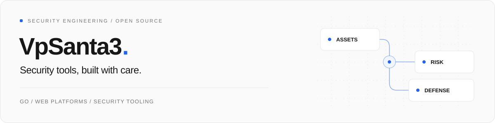
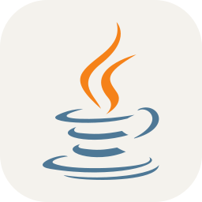
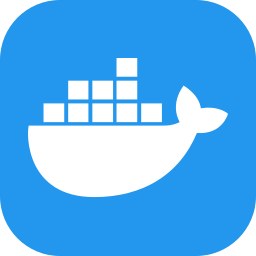
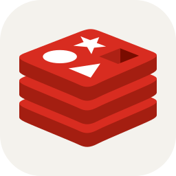
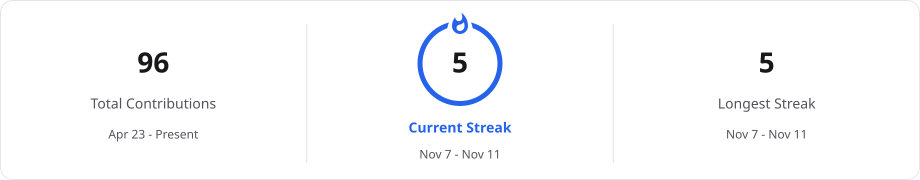

<picture>
  <source media="(prefers-color-scheme: dark)" srcset="assets/header-dark.svg">
  <source media="(prefers-color-scheme: light)" srcset="assets/header-light.svg">
  
</picture>

 

我用 **Go** 构建安全工具与平台，关注资产监控、漏洞治理和数据安全。也用 **React / Vue** 把复杂的安全流程做成清晰、可用的界面。

[查看全部项目 →](https://github.com/VpSanta33?tab=repositories) &nbsp;&nbsp; [在线体验 SRC Observatory ↗](https://vpsanta33.github.io/SRC-Monitoring/)

## 技术栈

  <picture><source media="(prefers-color-scheme: dark)" srcset="assets/icons/GoLang.svg"></picture>&nbsp;
  <picture><source media="(prefers-color-scheme: dark)" srcset="assets/icons/Java-Dark.svg"></picture>&nbsp;
  <picture><source media="(prefers-color-scheme: dark)" srcset="assets/icons/React-Dark.svg"></picture>&nbsp;
  <picture><source media="(prefers-color-scheme: dark)" srcset="assets/icons/VueJS-Dark.svg"></picture>&nbsp;
  <picture><source media="(prefers-color-scheme: dark)" srcset="assets/icons/TypeScript.svg"></picture>&nbsp;
  <picture><source media="(prefers-color-scheme: dark)" srcset="assets/icons/Docker.svg"></picture>&nbsp;
  <picture><source media="(prefers-color-scheme: dark)" srcset="assets/icons/GithubActions-Dark.svg"></picture>&nbsp;
  <picture><source media="(prefers-color-scheme: dark)" srcset="assets/icons/PostgreSQL-Dark.svg"></picture>&nbsp;
  <picture><source media="(prefers-color-scheme: dark)" srcset="assets/icons/Redis-Dark.svg"></picture>&nbsp;
  <picture><source media="(prefers-color-scheme: dark)" srcset="assets/icons/Git.svg"></picture>&nbsp;

`Go` · `Java` · `React` · `Vue` · `TypeScript` · `Docker` · `GitHub Actions` · `PostgreSQL` · `Redis` · `Git`

## GitHub 动态

  <picture>
    <source media="(prefers-color-scheme: dark)" srcset="profile/stats-dark.svg">
    
  </picture>
  <picture>
    <source media="(prefers-color-scheme: dark)" srcset="profile/languages-dark.svg">
    
  </picture>

<picture>
  <source media="(prefers-color-scheme: dark)" srcset="profile/streak-dark.svg">
  
</picture>

每日自动更新公开统计。语言占比反映仓库代码分布；统计口径与更新记录见<a href="docs/profile-cards.md">组件说明</a>。

## 精选项目

<table>
<tr>
<td width="50%" valign="top">
01 / ASSET MONITORING
<h3><a href="https://github.com/VpSanta33/SRC-Monitoring">SRC Observatory ↗</a></h3>

追踪 HackerOne、Bugcrowd 的公开项目与资产范围，保留增删改记录。Go 定时采集，React 静态展示。

<code>Go</code> <code>React</code> <code>GitHub Actions</code>

<a href="https://vpsanta33.github.io/SRC-Monitoring/">打开在线站点 →</a>

</td>
<td width="50%" valign="top">
02 / SECURITY OPERATIONS
<h3><a href="https://github.com/VpSanta33/Tower">Tower ↗</a></h3>

面向授权安全运营的资产风险平台，将扫描工具、任务队列、资产与 Worker 节点统一管理。

<code>Go</code> <code>Vue</code> <code>MongoDB</code>

<a href="https://github.com/VpSanta33/Tower#readme">了解项目 →</a>

</td>
</tr>
<tr>
<td width="50%" valign="top">
03 / VULNERABILITY MANAGEMENT
<h3><a href="https://github.com/VpSanta33/VulnArk">VulnArk ↗</a></h3>

将漏洞录入、资产关联、分派、SLA 跟踪与独立复测串成可追溯的修复流程。

<code>Go</code> <code>React</code> <code>MySQL</code>

<a href="https://github.com/VpSanta33/VulnArk#readme">了解项目 →</a>

</td>
<td width="50%" valign="top">
04 / DATA SECURITY
<h3><a href="https://github.com/VpSanta33/OpenDLP">OpenDLP ↗</a></h3>

数据防泄漏管理平台，包含敏感内容识别、用户态终端 Agent、事件处置与外发审批。持续完善中。

<code>Go</code> <code>JavaScript</code> <code>PostgreSQL</code>

<a href="https://github.com/VpSanta33/OpenDLP#readme">了解项目与能力边界 →</a>

</td>
</tr>
<tr>
<td width="50%" valign="top">
05 / APPLICATION SECURITY
<h3><a href="https://github.com/VpSanta33/ZhuWei-Rasp">ZhuWei-RASP ↗</a></h3>

探索应用运行时防护，结合 Java Agent、Go 管理平台与策略下发。目前处于 MVP 阶段。

<code>Go</code> <code>Java</code> <code>RASP</code>

<a href="https://github.com/VpSanta33/ZhuWei-Rasp#readme">了解项目与当前状态 →</a>

</td>
<td width="50%" valign="top">
06 / WEB APPLICATIONS
<h3><a href="https://github.com/VpSanta33/Wybo">Wybo ↗</a></h3>

数字商品销售平台，连接商城、订单、库存与代理中心，支持自动发货和经营数据管理。

<code>Go</code> <code>React</code> <code>PostgreSQL</code>

<a href="https://github.com/VpSanta33/Wybo#readme">了解项目 →</a>

</td>
</tr>
</table>

---

项目的具体能力、部署方式与进展见各仓库 README。欢迎通过对应仓库的 Issues 交流问题和建议。

主页组件与设计参考

统计卡片由 [GitHub Readme Stats Action](https://github.com/stats-organization/github-readme-stats-action) 生成，连续贡献记录来自 [GitHub Readme Streak Stats](https://github.com/DenverCoder1/github-readme-streak-stats)，技术图标来自 [Skill Icons](https://github.com/tandpfun/skill-icons)。

参考：[GitHub Profile 页面仓库使用指南](https://neusoftware.top/articles/2025/09/16/1758012543979.html)。图片由仓库内的工作流定时生成，支持深浅色主题。

